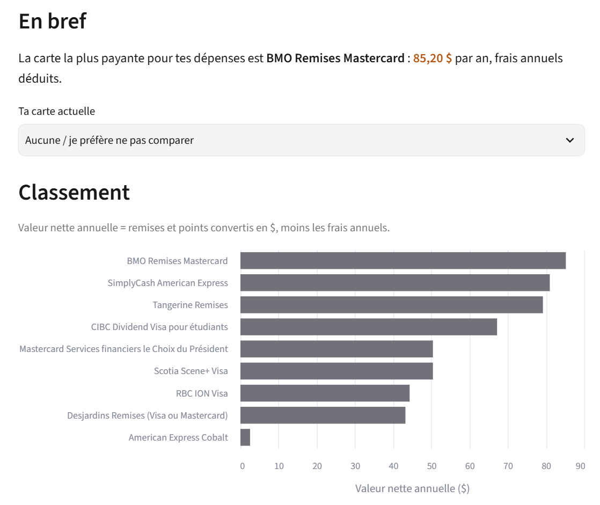
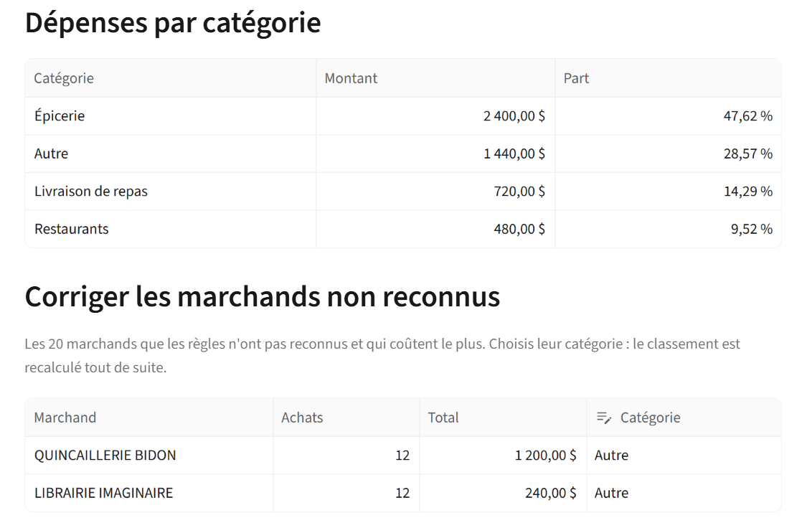

# Comparateur de cartes de crédit

Un petit outil web pour savoir **quelle carte de crédit canadienne t'aurait rapporté le plus**, à partir de tes vraies dépenses des 12 derniers mois.

Tu importes l'export CSV de ta carte Desjardins. L'outil classe tes achats par catégorie (épicerie, restaurants, essence…), puis calcule pour chaque carte sa **valeur nette annuelle** :

> remises en argent + points convertis en $ − frais annuels





*Captures faites avec un relevé fictif.*

## Ce que l'outil affiche

- La période analysée : les **12 derniers mois complets** du relevé (le mois en cours de l'export est laissé de côté).
- Une phrase de synthèse avec la carte la plus payante et, si tu indiques ta carte actuelle, ce que tu gagnerais à changer.
- Le classement des cartes, en graphique et en tableau, avec le **détail du calcul** de chacune : dépense, rendement et récompense par catégorie, catégories au choix retenues, plafonds dépassés.
- La répartition de tes dépenses par catégorie.
- Les 20 marchands non reconnus qui coûtent le plus, dont tu peux **corriger la catégorie** : le classement est recalculé tout de suite. Les corrections se téléchargent en CSV et se rechargent à la session suivante.
- Un interrupteur pour l'hypothèse « livraison de repas = restaurant ».
- Les sources des conditions de chaque carte, avec leur date de vérification.

## Vie privée

- Le relevé est **lu en mémoire** : rien n'est écrit sur disque ni envoyé ailleurs. Fermer la page efface tout.
- L'outil tourne sur ton ordinateur (`streamlit run`), pas en ligne.
- Le fichier de corrections contient les noms de tes marchands : garde-le dans `data/prive/`, que `.gitignore` exclut du dépôt.

## Comment les calculs sont faits

**Les dépenses.** Seuls les achats et les remboursements de la carte comptent. Les paiements de la carte, la remise de ta carte actuelle et les frais de crédit (intérêts) ne sont pas des dépenses.

**Les catégories.** Chaque marchand est classé par des règles de mots-clés (chaînes connues et mots génériques comme « PHARMACIE » ou « RESTO »). Ce qui n'est pas reconnu va dans « Autre », que tu peux corriger dans l'appli. Certaines sous-catégories ont un parent : IGA est de l'épicerie du réseau Sobeys ; une carte qui n'a pas de taux pour Sobeys applique son taux épicerie.

**Les récompenses.** Une seule formule pour les remises et les points :

```
valeur en $ = dépense × taux par dollar × valeur d'un point (en cents) ÷ 100
```

- Carte à remise : 2 % s'écrit `taux = 0,02` et `valeur du point = 100 ¢`.
- Carte à points : `taux` = points par dollar, et chaque programme a une **valeur fixe par point**, affichée dans l'appli.

Pour chaque achat, la carte applique le taux de sa catégorie, sinon celui du parent, sinon son taux de base (« autres »).

**Les plafonds.** Les dépenses d'un groupe plafonné sont cumulées sur l'année ou par mois civil ; la part au-delà du plafond gagne le taux de base.

**Les catégories au choix** (Tangerine) : l'outil essaie toutes les combinaisons et garde la plus payante.

Les montants sont des `Decimal`, arrondis au cent.

**Limites :** pas de bonus de bienvenue, d'assurances, de conditions de revenu ni de frais de change. Les plafonds mensuels sont appliqués par mois civil, alors que les cartes les appliquent par relevé. La valeur d'un point est une moyenne : elle dépend en réalité de la façon de l'échanger.

## Cartes comparées

| Carte | Type | Frais annuels |
|---|---|---|
| Desjardins Remises (Visa ou Mastercard) | remise | 0 $ |
| Tangerine Remises | remise | 0 $ |
| BMO Remises Mastercard | remise | 0 $ |
| CIBC Dividend Visa pour étudiants | remise | 0 $ |
| SimplyCash American Express | remise | 0 $ |
| Scotia Scene+ Visa | points (1 ¢) | 0 $ |
| RBC ION Visa | points (0,71 ¢) | 0 $ |
| Mastercard Services financiers le Choix du Président | points (0,1 ¢) | 0 $ |
| American Express Cobalt | points (1 ¢) | 191,88 $ |

Conditions vérifiées le 22 novembre 2026. Elles changent souvent : vérifie-les auprès de l'émetteur avant de demander une carte.

### Ajouter ou mettre à jour une carte

Les conditions sont saisies à la main dans deux fichiers, validés au chargement :

- `data/cartes.csv` : une ligne par carte (type de récompense, valeur du point, frais annuels, **source** et **date de vérification** obligatoires).
- `data/taux.csv` : une ligne par taux bonifié (catégorie, taux par dollar, plafond éventuel et sa période `an` ou `mois`, groupe de plafond partagé, `au_choix`). Chaque carte a obligatoirement un taux `autres`.

Les clés de catégories sont celles de `src/categories.py`.

## Installer et lancer

Il faut Python 3.11 ou plus récent.

```bash
python -m venv .venv
# Windows
.venv\Scripts\activate
# macOS / Linux
source .venv/bin/activate

pip install -r requirements.txt
streamlit run app.py
```

Dans AccèsD, exporte les transactions de ta **carte de crédit** en CSV (au moins 13 mois pour avoir 12 mois complets), puis importe le fichier dans l'appli. Le relevé du compte d'opérations n'est pas utilisé.

## Tests

```bash
python -m pytest -q
```

Les tests utilisent uniquement des relevés fictifs (`tests/donnees/`, `tests/fictif.py`). Les montants attendus du calcul sont faits à la main, en commentaire dans les tests. L'interface est testée avec `streamlit.testing` (`AppTest`).

## Organisation du code

```
app.py               # interface Streamlit (affichage seulement)
src/desjardins.py    # lecture des exports CSV Desjardins (carte et compte)
src/categories.py    # catégories et règles par mots-clés de marchand
src/depenses.py      # sélection des achats, fenêtre de 12 mois, corrections
src/cartes.py        # lecture et validation de data/cartes.csv et data/taux.csv
src/calcul.py        # valeur nette annuelle de chaque carte, classement
src/affichage.py     # formats ($, %, mois en français), phrases, tableaux
data/                # conditions des cartes (data/prive/ : relevés, jamais publié)
tests/               # tests pytest
```

Fait avec Python, Streamlit et Altair.

---

*Outil d'information, pas un conseil financier.*
